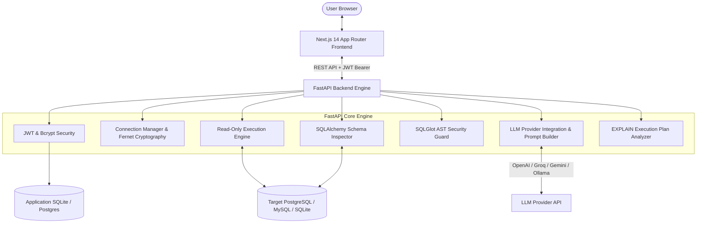

<div align="center">

# ⚡ QueryCraft AI
### Natural Language to SQL Query Builder & Database Assistant

[](LICENSE)
[](https://python.org)
[](https://fastapi.tiangolo.com)
[](https://nextjs.org)
[](https://www.typescriptlang.org)
[](https://tailwindcss.com)
[](https://github.com/tobymao/sqlglot)
[-brightgreen.svg)]()

<p align="center">
  A production-ready, security-first web application that translates natural language into verified, high-performance SQL queries. Features deterministic Abstract Syntax Tree (AST) security validation, live database schema inspection, Monaco SQL editing, Recharts visual analytics, and EXPLAIN execution plan optimization.
</p>

[Quickstart](#-quickstart-guide) •
[Architecture](#-system-architecture) •
[Security Model](#-security--ast-validation) •
[Features](#-key-features) •
[Docker Setup](#-docker-deployment) •
[API Reference](#-api-endpoints)

</div>

---

## 🌟 Key Features

- 🧠 **Schema-Aware Natural Language to SQL**: Formulates dialect-accurate SQL from natural language prompts by introspecting table structures, primary keys, and foreign key relations.
- 🛡️ **Deterministic SQL AST Security Guard**: Powered by `SQLGlot`. Strictly enforces Read-Only `SELECT` execution, rejects mutation DDL/DML (`INSERT`, `UPDATE`, `DELETE`, `DROP`, `ALTER`, `TRUNCATE`, `GRANT`), blocks semicolon multi-statement injection, and prevents sensitive catalog probing.
- 🔌 **Multi-Dialect & Multi-Database**: Seamlessly connects to **PostgreSQL**, **MySQL**, and **SQLite**. Includes a pre-seeded, realistic 8-table e-commerce database (`customers`, `orders`, `products`, `departments`, `employees`, etc.) for instant testing without external dependencies.
- 💻 **Monaco SQL Editor**: Full-featured developer editor with syntax highlighting, automatic SQL formatting, error badges, copy/download, and `Ctrl+Enter` execution shortcuts.
- 📊 **Multi-View Analytics**: View query results in an interactive sortable/paginated Table, CSV export, raw JSON viewer, or customizable **Recharts** charts (Bar, Line, and Pie charts with intelligent axis profiling).
- 🔍 **AI Query Explainer & Optimizer**: Step-by-step logic breakdown, operations identification, execution plan inspection (`EXPLAIN QUERY PLAN`), and actionable index/performance suggestions.
- 🔒 **Enterprise-Grade Cryptography & Auth**: User registration/login with bcrypt password hashing and JWT access & refresh tokens. Database credentials and passwords are encrypted at rest using **Fernet (AES-128-CBC)**.
- 🤖 **Provider-Agnostic LLM Engine**: Works with OpenAI, Groq, Google Gemini, and Local Ollama, plus an intelligent built-in heuristic fallback engine for instant offline execution.

---

## 🏗️ System Architecture



---

## 🚀 Quickstart Guide

### 1. Clone the Repository
```bash
git clone https://github.com/your-username/querycraft-ai.git
cd querycraft-ai
```

### 2. Backend Setup
```bash
cd backend

# Create and activate virtual environment
python -m venv env
# Windows:
.\env\Scripts\activate
# Linux/macOS:
source env/bin/activate

# Install dependencies
pip install -r requirements.txt

# Seed the realistic sample e-commerce database
python app/utils/sample_db_seeder.py

# Launch FastAPI backend server
python run.py
```
Backend will be live at `http://localhost:8000` with Swagger documentation at `http://localhost:8000/docs`.

### 3. Frontend Setup
In a new terminal window:
```bash
cd frontend

# Install npm packages
npm install

# Start Next.js development server
npm run dev
```
Frontend will be live at `http://localhost:3000`.

### 4. 1-Click Demo Login
1. Open `http://localhost:3000` in your browser.
2. Click **"1-Click Demo Login"** on the login page to instantly enter the workspace pre-loaded with the sample database!

---

## 🐳 Docker Deployment

Run the complete multi-container stack with a single command:

```bash
docker-compose up --build
```

- **Frontend**: `http://localhost:3000`
- **Backend API**: `http://localhost:8000`
- **Healthcheck Endpoint**: `http://localhost:8000/api/health`

---

## 🛡️ Security & AST Validation

QueryCraft AI treats database safety as a deterministic mathematical guarantee rather than relying on natural language prompts or fragile regex:

1. **AST Node Inspection**: Before any query touches the database driver, it is parsed by SQLGlot into an Abstract Syntax Tree.
2. **Prohibited Expression Blocker**:
   - `Insert`, `Update`, `Delete`, `Drop`, `Alter`, `TruncateTable`, `Create`, `Grant`, `Revoke`, `Pragma`, `Command` are deterministically rejected.
3. **Multi-Statement Defense**: If `len(parsed_statements) > 1`, execution is blocked immediately to prevent `; DROP TABLE ...` chaining.
4. **Auto-LIMIT Clamping**: If a query omits a `LIMIT` clause, `LIMIT 100` is automatically injected into the AST. If a user inputs an oversized limit (`LIMIT 1000000`), it is clamped to safety threshold (1,000 rows).
5. **Read-Only Transaction Isolation**: Database sessions run in read-only mode with a 15-second query timeout.

---

## 🧪 Automated Testing

The backend includes a comprehensive automated test suite covering authentication, database connections, schema introspection, SQL execution, and dangerous attack vectors:

```bash
cd backend
python -m pytest -v
```

### Test Suite Results:
```
tests/test_auth.py::test_register_and_login_flow PASSED                  [  9%]
tests/test_connections_and_queries.py::test_connections_schema_and_query_flow PASSED [ 18%]
tests/test_sql_security.py::test_valid_select_query PASSED               [ 27%]
tests/test_sql_security.py::test_block_drop_table PASSED                 [ 36%]
tests/test_sql_security.py::test_block_delete_mutation PASSED            [ 45%]
tests/test_sql_security.py::test_block_update_mutation PASSED            [ 54%]
tests/test_sql_security.py::test_block_insert_mutation PASSED            [ 63%]
tests/test_sql_security.py::test_block_multi_statement_injection PASSED  [ 72%]
tests/test_sql_security.py::test_block_sensitive_catalog_access PASSED   [ 81%]
tests/test_sql_security.py::test_clamp_oversized_limit PASSED            [ 90%]
tests/test_sql_security.py::test_cte_with_select_is_allowed PASSED       [100%]
============================= 11 passed in 1.11s ==============================
```

---

## 📡 API Endpoints

| Category | Method | Endpoint | Description |
| :--- | :--- | :--- | :--- |
| **Auth** | `POST` | `/api/auth/register` | Register new user account |
| **Auth** | `POST` | `/api/auth/login` | Authenticate and obtain JWT |
| **Auth** | `POST` | `/api/auth/refresh` | Refresh access token |
| **Auth** | `GET` | `/api/auth/me` | Current user profile |
| **Connections** | `GET` | `/api/connections` | List user connections |
| **Connections** | `POST` | `/api/connections` | Add new encrypted connection |
| **Connections** | `POST` | `/api/connections/{id}/test` | Health-check connection |
| **Connections** | `DELETE` | `/api/connections/{id}` | Delete connection |
| **Schema** | `GET` | `/api/schema/{id}` | Deep schema introspection |
| **AI** | `POST` | `/api/ai/generate-sql` | Translate NL to verified SQL |
| **AI** | `POST` | `/api/ai/explain-sql` | Step-by-step query explanation |
| **AI** | `POST` | `/api/ai/optimize-sql` | EXPLAIN plan & index suggestions |
| **Query** | `POST` | `/api/query/validate` | AST syntax & security verification |
| **Query** | `POST` | `/api/query/execute` | Safe query execution & audit log |
| **Query** | `GET` | `/api/query/history` | Audit log of executed queries |
| **Bookmarks** | `GET` | `/api/saved-queries` | List saved queries |
| **Bookmarks** | `POST` | `/api/saved-queries` | Save/bookmark query |
| **Health** | `GET` | `/api/health` | Health status and engine metrics |

---

## 📂 Project Structure

```
querycraft-ai/
│
├── backend/
│   ├── app/
│   │   ├── api/
│   │   │   ├── routes/         # auth, connections, schema, ai, query, saved_queries, health
│   │   │   └── deps.py         # JWT authentication dependency
│   │   ├── core/               # config, security, database engine
│   │   ├── models/             # User, DatabaseConnection, QueryHistory, SavedQuery
│   │   ├── schemas/            # Pydantic v2 validation models
│   │   ├── services/           # connection, schema, execution, optimizer services
│   │   ├── ai/                 # provider, prompt_builder, heuristic_engine, sql_generator, explainer
│   │   ├── security/           # SQLGlot AST validator & encryption
│   │   └── utils/              # sample_db_seeder.py
│   ├── tests/                  # Pytest automated test suite
│   ├── Dockerfile
│   ├── requirements.txt
│   └── run.py
│
├── frontend/
│   ├── app/                    # Next.js App Router pages
│   │   ├── page.tsx            # Dashboard
│   │   ├── playground/         # SQL Playground workspace
│   │   ├── connections/        # Database manager
│   │   ├── schema/             # Schema visualizer
│   │   ├── history/            # Query execution audit log
│   │   ├── saved-queries/      # Bookmarked queries
│   │   ├── settings/           # AI provider & security settings
│   │   ├── docs/               # In-app architecture documentation
│   │   ├── login/              # Login with 1-click Demo
│   │   └── register/           # Registration
│   ├── components/             # Sidebar, Navbar, SqlEditor, ResultsTable, ChartView, SchemaTree, AiAssistant
│   ├── lib/                    # api client, auth context, types, utils
│   ├── Dockerfile
│   └── package.json
│
├── database/
│   └── sample_ecommerce.db     # Pre-seeded SQLite database
│
├── docs/
│   ├── architecture.md         # System design & component interactions
│   ├── api.md                  # REST API reference
│   └── security.md             # Threat model & AST validation
│
├── .github/workflows/ci.yml    # GitHub Actions CI pipeline
├── docker-compose.yml          # Multi-container orchestration
├── .env.example                # Configuration template
├── CONTRIBUTING.md             # Contribution guidelines
├── CODE_OF_CONDUCT.md          # Contributor Covenant v2.1
├── LICENSE                     # MIT License
└── README.md
```

---

## 🤝 Contributing

Contributions are welcomed! Please read [CONTRIBUTING.md](CONTRIBUTING.md) and [CODE_OF_CONDUCT.md](CODE_OF_CONDUCT.md) before submitting a Pull Request.

---

## 📄 License

This project is licensed under the MIT License - see the [LICENSE](LICENSE) file for details.
