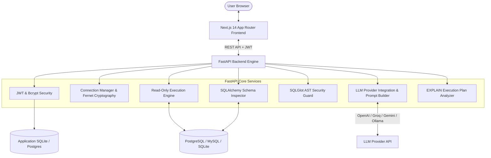

# QueryCraft AI — System Architecture

## Overview
**QueryCraft AI** is an intelligent, secure, schema-aware natural language to SQL translation system designed for production database interaction. It eliminates the risks of naive LLM wrappers through deterministic Abstract Syntax Tree (AST) security validation, connection pooling, multi-dialect support, and visual analytics.

---

## 1. High-Level Architecture Diagram

---

## 2. Component Breakdown

### A. Frontend (Next.js 14)
- **App Router**: Type-safe routes (`/`, `/playground`, `/connections`, `/schema`, `/history`, `/saved-queries`, `/settings`, `/docs`, `/login`, `/register`).
- **Monaco Editor (`@monaco-editor/react`)**: Interactive SQL workspace with formatting, copy, download, keyboard shortcuts (`Ctrl+Enter`), and error highlighting.
- **Recharts Visualization**: Automatic data profiling and multi-axis visualization (Bar Charts, Line Charts, Pie Charts).
- **Client Auth Provider**: Token-based JWT storage in localStorage with auto-refresh and active database switching.

### B. Backend Engine (FastAPI & Python 3.12+)
- **Provider-Independent AI Engine**: Standardized OpenAI-compatible HTTP interface supporting OpenAI, Groq, DeepSeek, Local Ollama, and Google Gemini.
- **Schema-Aware Heuristic Engine**: Zero-config, deterministic local semantic query formulation that works offline out of the box.
- **AST Security Guard (`sqlglot`)**: Deterministically parses queries into expression trees, blocking DDL/DML mutations, multiple statements, catalog tampering, and clamping `LIMIT` parameters.
- **Credential Cryptography (`cryptography.fernet`)**: Encrypts database connection strings and passwords at rest using AES-128-CBC with PKCS7 padding.
- **Connection Pooling & Read-Only Execution**: Wraps database calls in timeout constraints and read-only transactions, isolating user workspaces.
